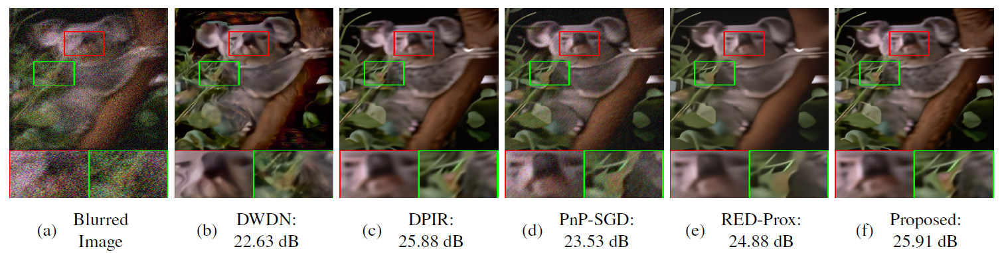
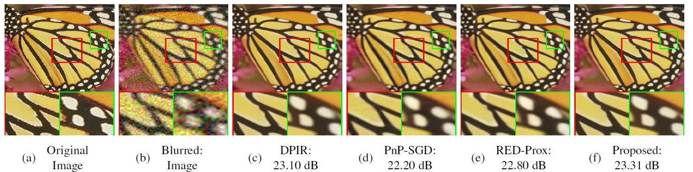

# PnP-EFISTA: Plug-and-Play EFISTA for Image Restoration under High Measurement Noise

Official PyTorch implementation of

> **Plug-and-Play EFISTA for Image Restoration under High Measurement Noise**
> Avinash Kumar, Koyyada Dinesh Kumar, Sujit Kumar Sahoo
> School of Electrical Sciences, Indian Institute of Technology Goa
> *Journal of Visual Communication and Image Representation* (under review)

PnP-EFISTA extends the Enhanced FISTA (EFISTA) of
[Kumar & Sahoo, SPCOM 2024](https://doi.org/10.1109/SPCOM60851.2024.10631604) to a plug-and-play
framework.

Abstract
----------
Image restoration problems, such as image deblurring and super-resolution, remain challenging due to their ill-posed nature, particularly in the presence of high measurement noise. The Fast Iterative Shrinkage-Thresholding Algorithm (FISTA) has been widely used for solving linear inverse problems, with several enhancements and extensions developed over time. In this paper, we propose a Plug-and-Play Enhanced FISTA (PnP-EFISTA) framework that incorporates fast-forward accelerated gradient-descent steps and adaptive denoising to improve restoration. The proposed framework enables the integration of learning-based denoisers without requiring modifications to the underlying restoration model. Extensive experiments on image deblurring and super-resolution demonstrate that PnP-EFISTA is particularly effective at high AWGN levels, achieving competitive or improved Peak Signal-to-Noise Ratio (PSNR) and Structural Similarity Index measure (SSIM) performance compared with state-of-the-art restoration algorithms.

Image Deblurring
----------
* Quantitative comparison
  
|  Dataset  | Noise (σ) |     DWDN     |       DPIR |            RED-Prox      |         PnP-SGD       |       **Proposed** |
|:---------:|:---------:|:---------:|:---------:|:---------:|:---------:|:---------:|
| Set3c   | 10% | 23.71 / 0.810 | 25.31 / 0.837 | 25.53 / 0.841 | 24.33 / 0.735 | **25.67** / **0.847** |
| Set3c   | 15% | 21.85 / 0.727 | 23.61 / 0.790 | 23.69 / 0.788 | 22.18 / 0.635 | **24.18** / **0.811** |
| Set3c   | 20% | 20.21 / 0.635 | 22.44 / 0.748 | 22.20 / 0.739 | 20.52 / 0.553 | **23.04** / **0.778** |
| Set3c   | 25% | 18.77 / 0.559 | 21.58 / 0.713 | 20.89 / 0.692 | 19.19 / 0.487 | **22.16** / **0.746** |
| CBSD100 | 10% | 24.91 / 0.647 | 25.62 / 0.674 | 25.38 / 0.659 | 24.26 / 0.533 | **25.64** / **0.678** |
| CBSD100 | 15% | 23.40 / 0.581 | 24.68 / 0.629 | 24.20 / 0.600 | 22.61 / 0.417 | **24.75** / **0.635** |
| CBSD100 | 20% | 21.80 / 0.508 | 24.06 / 0.599 | 23.22 / 0.556 | 21.25 / 0.333 | **24.14** / **0.606** |
| CBSD100 | 25% | 20.11 / 0.439 | 23.62 / 0.578 | 22.26 / 0.520 | 20.08 / 0.272 | **23.68** / **0.584** |
* Qualitative comparison

   


Single Image Super-Resolution
----------
* Quantitative comparison
  
|  Dataset         |      Noise        |       DPIR           |         RED-Prox        |           PnP-SGD   |        **Proposed**   |
|:---------:|:---------:|:---------:|:---------:|:---------:|:---------:|
| Set3c   | 10% | 23.18 / 0.771 | **23.32** / **0.780** | 22.70 / 0.736 | 23.24 / 0.772 |
| Set3c   | 15% | 22.07 / 0.730 | 22.05 / **0.734** | 21.43 / 0.676 | **22.09** / 0.728 |
| Set3c   | 20% | **21.20** / **0.695** | 20.93 / 0.692 | 20.35 / 0.621 | 21.16 / 0.688 |
| Set3c   | 25% | 20.44 / **0.662** | 19.60 / 0.638 | 19.32 / 0.569 | **20.46** / 0.657 |
| SRBSD68 | 10% | 24.65 / 0.642 | 24.62 / **0.643** | 24.17 / 0.595 | **24.68** / **0.643** |
| SRBSD68 | 15% | 23.90 / 0.609 | 23.64 / 0.597 | 23.14 / 0.527 | **23.98** / **0.611** |
| SRBSD68 | 20% | 23.29 / 0.585 | 22.63 / 0.555 | 22.18 / 0.469 | **23.43** / **0.588** |
| SRBSD68 | 25% | 22.75 / 0.564 | 20.60 / 0.474 | 21.26 / 0.420 | **22.98** / **0.569** |

* Qualitative comparison

  

## Usage

Run this script to get the PSNR and SSIM table. 
```bash
python DC/Test_DC_EFISTA.py
python SC/Test_SC_EFISTA.py
```
or open them in Spyder and press Run. Results are saved to `results/DC/` and `results/SC/`:
the restored images and one Excel workbook per run.

Citation
----------
```BibTex
@article{kumar2026pnpefista,
  title   = {Plug-and-Play EFISTA for Image Restoration under High Measurement Noise},
  author  = {Kumar, Avinash and Kumar, Koyyada Dinesh and Sahoo, Sujit Kumar},
  journal = {Journal of Visual Communication and Image Representation},
  year    = {2026},
  note    = {Under review}
}

@INPROCEEDINGS{Avinash2024EFISTA_NBID,
  author={Kumar, Avinash and Sahoo, Sujit Kumar},
  booktitle={2024 International Conference on Signal Processing and Communications (SPCOM)}, 
  title={Enhanced FISTA for Non-Blind Image Deblurring}, 
  year={2024},
  volume={},
  number={},
  pages={1-5},
  keywords={PSNR;Thresholding (Imaging);AWGN;Simulation;Noise;Signal processing algorithms;Robustness;Inverse Problems;Image deblurring;Denoising;FISTA;EFISTA;Gradient Descent;Convergence Speed;Execution Time},
  doi={10.1109/SPCOM60851.2024.10631604}}

```

## Contact

Avinash Kumar — avinash20242202@iitgoa.ac.in
Sujit Kumar Sahoo (corresponding author) — sujit@iitgoa.ac.in
